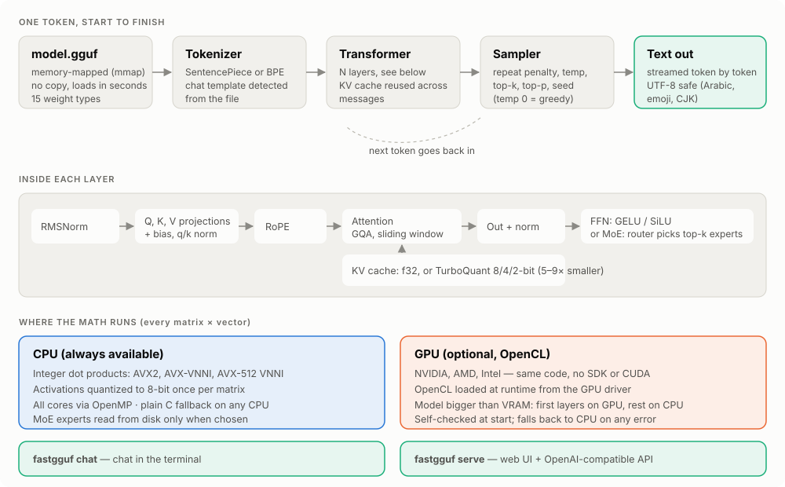
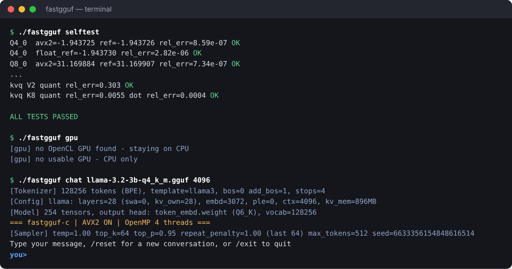
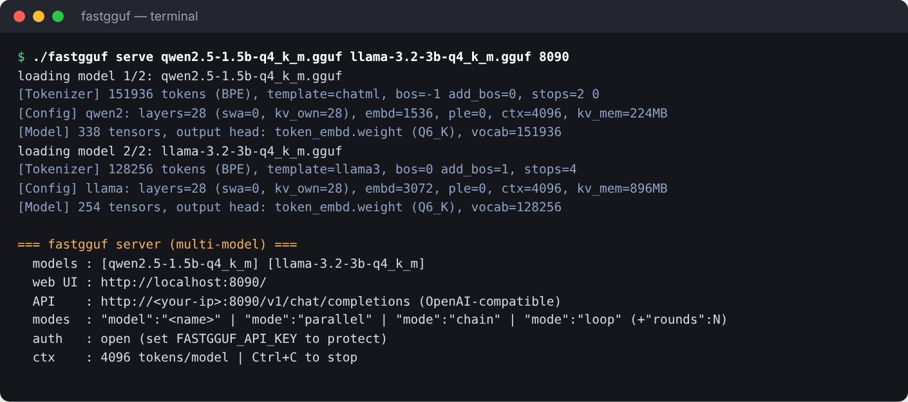
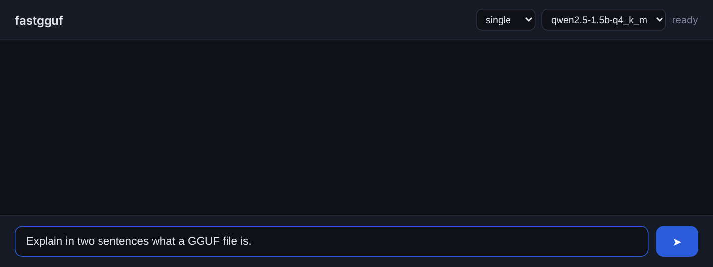
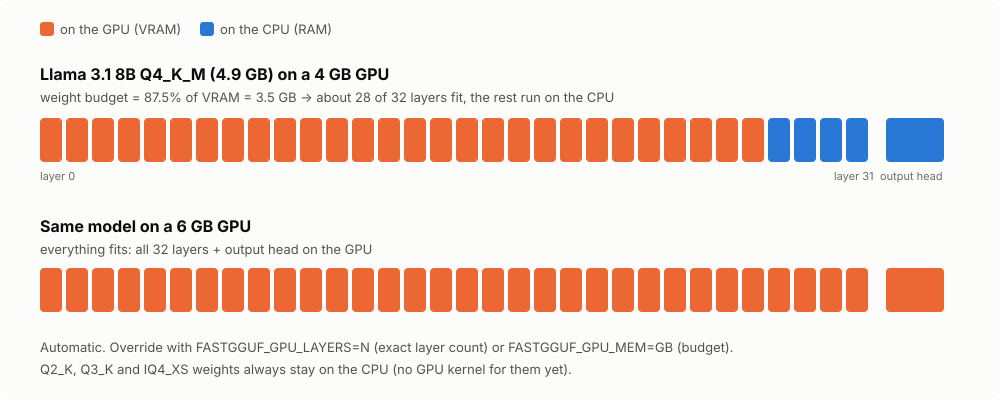
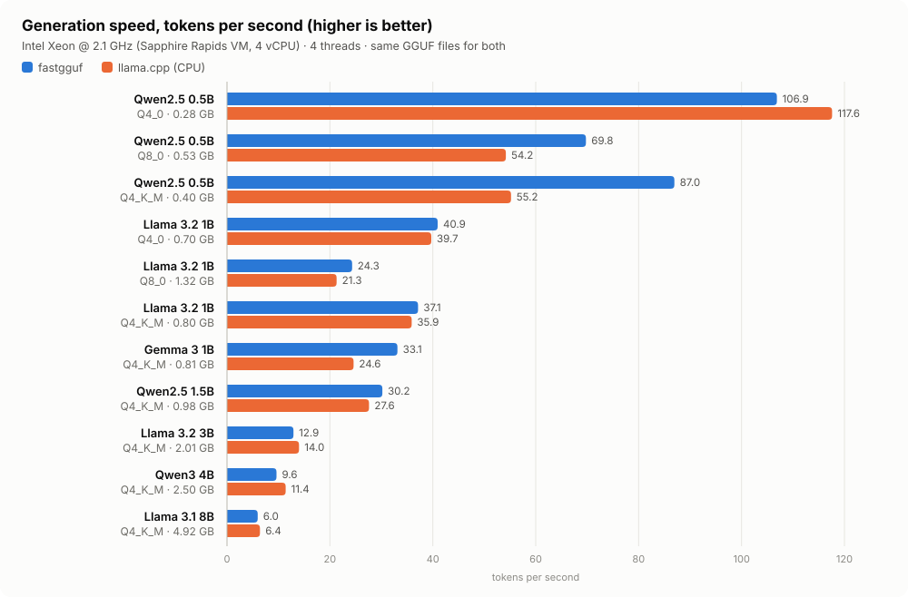
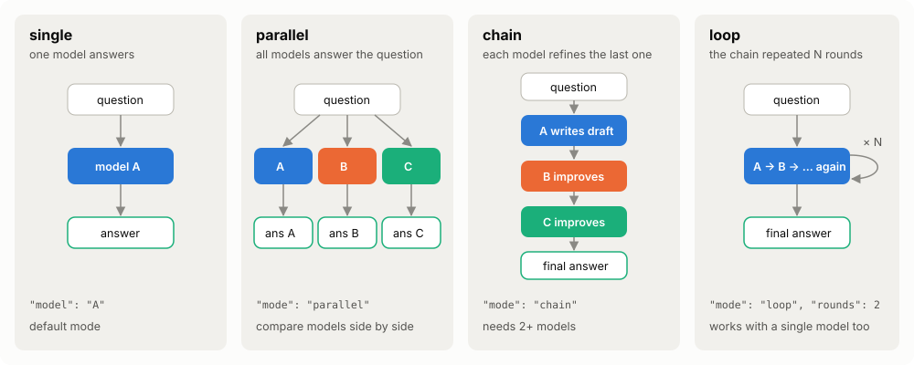

<p align="center">
  
</p>

# fastgguf

**Run large language models (GGUF files) on your own computer — one C file, no dependencies.**

fastgguf is a small inference engine written in plain C. Point it at a `.gguf` model file
(the format used by llama.cpp, LM Studio and Ollama) and you can chat in the terminal or open
a web page with a chat UI and an OpenAI-compatible API. It runs on any CPU and uses your
NVIDIA, AMD or Intel graphics card through OpenCL when one is present.

- **One file**: `fastgguf.c` (~5,000 lines). Builds in a few seconds with `gcc`.
- **No dependencies**: no Python, no CUDA toolkit, no CMake. The GPU driver is loaded at runtime.
- **Private**: everything runs locally; nothing is sent anywhere.



---

## Contents

- [Features](#features)
- [Quick start](#quick-start)
- [Supported models](#supported-models)
- [Supported hardware (CPUs and GPUs)](#supported-hardware)
- [Speed](#speed)
- [Web UI and API](#web-ui-and-api)
- [Settings (environment variables)](#settings)
- [Building from source](#building-from-source)
- [Limitations](#limitations)

---

## Features

| | |
|---|---|
| **Terminal chat** | `fastgguf chat model.gguf` — streaming replies, conversation memory, `/reset`, `/exit`, tokens/second after every reply. |
| **Web UI** | `fastgguf serve model.gguf` then open `http://localhost:8080` — a dark chat page built into the binary. |
| **OpenAI-compatible API** | `POST /v1/chat/completions` (streaming and non-streaming) and `GET /v1/models`. Works with the official `openai` Python/JS clients and tools that accept a custom base URL. |
| **Several models at once** | Load up to 4 models in one server and pick one per request, or combine them (below). |
| **Multi-model modes** | `parallel` — every model answers; `chain` — each model improves the previous answer; `loop` — repeat the chain N rounds (works with one model as self-refinement). |
| **GPU acceleration** | OpenCL on NVIDIA, AMD and Intel GPUs. Models larger than VRAM are split automatically: first layers on the GPU, the rest on the CPU. |
| **Fast CPU kernels** | Integer dot products with AVX2 / AVX-VNNI / AVX-512 VNNI, all cores via OpenMP. Works without AVX2 too (portable C path). |
| **Mixture-of-Experts** | Qwen3 MoE models. Experts are read from disk only when the router picks them, so a model larger than your RAM can still run. |
| **TurboQuant KV cache** | Optional compressed attention cache (`FASTGGUF_KV=turbo`): 5–9× less memory for long conversations, with a Hadamard rotation that keeps accuracy. |
| **Prompt cache reuse** | The server keeps the previous conversation in the KV cache and only processes the new part of each request. |
| **Sampling controls** | temperature, top-k, top-p, repeat penalty, seed (reproducible replies), greedy mode. |
| **Unicode everywhere** | Arabic, CJK and emoji are printed correctly, including on the Windows console and in file paths. |
| **Self-test** | `fastgguf selftest` checks every CPU kernel against a reference; the GPU checks itself before it is used. |
| **Tools** | `inspect` (architecture, quant types, MoE size), `dump` (all metadata), `gpu` (list GPUs). |

---

## Quick start

### 1. Get the program

**Windows** — download **`fastgguf-…-windows-x64.zip`** from the
[**Releases page**](../../releases/latest), unzip it, done (no installation; use the `-compat` zip only
on very old CPUs without AVX2). Or build it yourself:

```bat
build.bat
```

(needs `gcc` from [w64devkit](https://github.com/skeeto/w64devkit) or MSYS2 — see [Building from source](#building-from-source)).

**Linux / macOS**

```sh
make
./fastgguf selftest        # optional: should print ALL TESTS PASSED
```

### 2. Get a model

Download any `.gguf` file of a [supported model](#supported-models) from
[Hugging Face](https://huggingface.co/models?library=gguf). Good first choices:

| Your RAM | Try | File size |
|---|---|---|
| 4 GB | Qwen2.5 1.5B Instruct, Q4_K_M | ~1.0 GB |
| 8 GB | Llama 3.2 3B Instruct or Qwen3 4B, Q4_K_M | 2–2.5 GB |
| 16 GB | Llama 3.1 8B / Qwen3 8B / Mistral 7B Instruct, Q4_K_M | 4.5–5 GB |
| 32 GB+ | Qwen3 30B-A3B (MoE), Q4_K_M | ~18 GB |

The file should be at most about 2/3 of your RAM (or of your VRAM if you want it fully on the GPU).

### 3. Run it

**Chat in the terminal**

```sh
./fastgguf chat model.gguf               # Windows: fastgguf.exe chat model.gguf
```

On Windows you can also **drag a `.gguf` file onto `chat.bat`**.



**Web UI + API**

```sh
./fastgguf serve model.gguf              # then open http://localhost:8080
```

On Windows, **drag one or more `.gguf` files onto `server.bat`** — the browser opens by itself.





### All commands

```
fastgguf chat     model.gguf [ctx] [--temp 1.0] [--top-k 64] [--top-p 0.95]
                  [--repeat-penalty 1.0] [--repeat-last-n 64] [--max-tokens 512] [--seed N]
fastgguf serve    model.gguf [model2.gguf ... up to 4] [port 8080] [ctx 4096]
fastgguf inspect  model.gguf      # architecture, weight types, MoE size
fastgguf dump     model.gguf      # every metadata key
fastgguf gpu                      # list GPUs and check OpenCL
fastgguf selftest                 # check the math kernels
```

`ctx` is the context length in tokens (chat default 2048, server default 4096). Chat
defaults follow Google's Gemma recommendation (temp 1.0, top-k 64, top-p 0.95);
`--temp 0` gives deterministic (greedy) output.

The Makefile also builds two single-purpose programs: `fastgguf-server` (only `serve`) and
`fastgguf-console` (only terminal chat), handy for double-click use on Windows.

---

## Supported models

fastgguf reads the architecture name stored inside the GGUF file
(`fastgguf inspect model.gguf` shows it).

| Architecture in file | Model families | Notes |
|---|---|---|
| `llama` | Llama 2, Llama 3 / 3.1 / 3.2 / 3.3, Mistral 7B, TinyLlama, SmolLM2 and other Llama-architecture fine-tunes | Chat template chosen automatically (Llama 3 or Mistral `[INST]`). |
| `mistral` | Mistral models exported with this name | Same path as `llama`. |
| `qwen2` | Qwen2, Qwen2.5 (incl. Coder / Math) | ChatML template. |
| `qwen3` | Qwen3 dense (0.6B – 32B) | q/k norm supported. |
| `qwen3moe` | Qwen3 MoE (30B-A3B, 235B-A22B) | Experts streamed from disk. |
| `gemma3` | Gemma 3 (1B – 27B) text | Sliding-window attention, RoPE scaling. |
| `gemma4` | Gemma 4 | Per-layer embeddings, shared KV layers. |

Anything else prints a warning and is tried with the Llama code path — it may work for
close relatives, but usually will not. Supported chat templates: Llama 3, ChatML (Qwen), Mistral/Llama 2 `[INST]`, Gemma, Gemma 4 — models trained on another template (for example the DeepSeek-R1 distills) run, but answer worse. **Not supported:** Phi, Gemma 1/2, DeepSeek V2/V3,
Qwen2 MoE (shared experts), GPT-OSS, vision/multimodal projectors, embedding models.

### Weight (quantization) types

| Type | Bits/weight | CPU | GPU | Recommendation |
|---|---|---|---|---|
| **Q4_K** (in Q4_K_M files) | 4.5 | fast integer kernel | yes | best size/quality balance |
| **Q5_K, Q6_K** | 5.5, 6.6 | fast | yes | higher quality |
| **Q8_0** | 8.5 | fast | yes | near-lossless |
| **Q4_0** | 4.5 | fastest kernel | yes | a little faster than Q4_K_M for small models (< 2B), see [Speed](#speed) |
| **IQ4_NL** | 4.5 | fast | yes | |
| **IQ4_XS** | 4.25 | fast | CPU only | |
| **Q2_K, Q3_K** | 2.6, 3.4 | fast | CPU only | low quality, for very large models |
| Q5_0, Q5_1, Q4_1 | 5.5, 6, 5 | fast | yes | |
| F16, BF16, F32 | 16–32 | slow (memory-bound) | yes | unquantized |

> **Mixed files:** in models whose layer width is not a multiple of 256 (for example Qwen2.5 0.5B,
> width 896, and Gemma 3 1B, width 1152), a Q4_K_M file also contains Q5_0 and Q8_0 weights, and a
> Q5_K_M file Q5_1 weights. All of these have fast kernels, so any of the usual files works well.

---

## Supported hardware

### Operating systems

Windows 10/11, Linux, macOS. The prebuilt Windows download is a single static `.exe` — nothing to install.

### CPUs

| CPU | Path used | Speed |
|---|---|---|
| Intel 4th gen Core (Haswell, 2013) and newer, AMD Ryzen / EPYC (Zen, 2017) and newer — **any x86-64 with AVX2** | AVX2 integer kernels | ★★★ |
| Intel 12th gen+ (Alder Lake: AVX-VNNI), Intel Ice Lake / Sapphire Rapids, AMD Zen 4/5 (AVX-512 VNNI) | AVX2 kernels + VNNI dot-product instruction | ★★★+ |
| Older x86-64 without AVX2 (Sandy/Ivy Bridge, AMD FX, Atom/Celeron) | portable C | ★ |
| ARM: Apple Silicon (M1–M4), Snapdragon, Raspberry Pi 4/5 | portable C (no NEON kernels yet) | ★ |

All cores are used through OpenMP (set `OMP_NUM_THREADS` to change it). Generation speed is
limited mostly by **memory bandwidth**: dual-channel DDR5 is roughly 1.7× faster than
dual-channel DDR4 for the same model.

### GPUs

fastgguf uses **OpenCL**, which ships with normal graphics drivers — no CUDA toolkit or
ROCm SDK needed. Run `fastgguf gpu` to see what it finds.

| GPU | Status |
|---|---|
| **NVIDIA** GeForce / RTX / Quadro (any card with a current driver) | supported, used automatically |
| **AMD** Radeon RX (Adrenalin driver on Windows, ROCm or Mesa rusticl on Linux) | supported, used automatically |
| **Intel** Arc (discrete) | supported, used automatically |
| Intel / AMD **integrated** graphics (Iris Xe, UHD, Radeon 680M/780M) | supported, but only with `FASTGGUF_GPU=on` (by default integrated GPUs are skipped, since they share RAM with the CPU) |
| Apple GPUs (Metal) | not supported — runs on the CPU |

The best discrete GPU (most VRAM) is picked automatically. Before use, the GPU runs a
self-check against the CPU; if anything fails, fastgguf silently stays on the CPU.



---

## Speed

### Measured: fastgguf vs llama.cpp on the same CPU

Measured in a cloud VM: **Intel Xeon @ 2.8 GHz, 4 vCPUs (AVX-512), 15 GB RAM, no GPU.** Both engines read the *same* GGUF files, generate 128 tokens with 4 threads, and the mean of 3 runs is reported (fastgguf: `fastgguf chat … --temp 0 --max-tokens 128`; llama.cpp: `llama-bench -p 0 -n 128`). The files were made with `tools/synth_gguf.py`: exact layer sizes and weight types of the real models, random values (this VM could not download models). Raw data: [`docs/benchmark.json`](docs/benchmark.json).



| Model | Weights | File | fastgguf tok/s | llama.cpp tok/s | fastgguf / llama.cpp |
|---|---|---|---|---|---|
| Qwen2.5 0.5B | Q4_0 | 0.28 GB | **43.0** | 69.2 | 62 % |
| Qwen2.5 0.5B | Q8_0 | 0.53 GB | **33.5** | 39.7 | 84 % |
| Qwen2.5 0.5B | Q4_K_M | 0.40 GB | **36.6** | 43.5 | 84 % |
| Llama 3.2 1B | Q4_0 | 0.70 GB | **18.5** | 28.6 | 65 % |
| Llama 3.2 1B | Q8_0 | 1.32 GB | **15.3** | 18.0 | 85 % |
| Llama 3.2 1B | Q4_K_M | 0.80 GB | **19.9** | 27.6 | 72 % |
| Gemma 3 1B | Q4_K_M | 0.81 GB | **18.1** | 24.6 | 73 % |
| Qwen2.5 1.5B | Q4_K_M | 0.98 GB | **16.0** | 20.8 | 77 % |
| Llama 3.2 3B | Q4_K_M | 2.01 GB | **7.6** | 10.9 | 70 % |
| Qwen3 4B | Q4_K_M | 2.50 GB | **4.9** | 8.2 | 60 % |
| Llama 3.1 8B | Q4_K_M | 4.92 GB | **3.5** | 4.9 | 72 % |

**What the numbers say**

- fastgguf generates text at **roughly 60–85 % of llama.cpp's speed** on this CPU (Q4_K_M and Q8_0 files
  60–85 %, Q4_0 62–65 %, where llama.cpp re-arranges the weights into a faster layout at load time).
- On a single core the two are close; llama.cpp spreads more of each token's work across cores, so the
  gap grows with more threads (Llama 3.2 1B Q4_K_M):

| Threads | fastgguf tok/s | llama.cpp tok/s |
|---|---|---|
| 1 | 7.1 | 8.2 |
| 2 | 12.1 | 14.3 |
| 4 | 17.2 | 24.8 |

- Recent speed-ups: the K-quant kernels (Q4_K / Q5_K / Q6_K) now sum each 256-value block in integers
  with one scale for the activations, like llama.cpp — about 1.2–1.7× faster generation for Q4_K_M files
  (Llama 3.2 1B: 11.8 → 20 tok/s). Integer kernels for Q5_0 / Q5_1 / Q4_1 made Gemma 3 1B and
  Qwen2.5 0.5B Q4_K_M files 4.5–5× faster (they store many weights as Q5_0).
- **Reading long prompts is much slower than in llama.cpp** (about 7 vs 180 tokens/s for Llama 3.2 1B),
  because fastgguf processes prompt tokens one by one instead of in batches.
- A 4-core cloud VM is slow hardware; a recent desktop with more cores and faster memory should be several
  times faster (not measured here). Run `tools/bench.py` to get numbers for your own machine.
- For reference, people read at roughly 5 tokens per second, so anything above that feels fluent.

### What to expect on your hardware

For each new token, the whole model is read from memory once, so **the upper limit is
roughly memory bandwidth ÷ model file size**. The table shows that ceiling for a few
common setups — real speed is always lower, and fastgguf is currently slower than llama.cpp
(see above). **These numbers are calculated, not measured.**

| Hardware | Memory bandwidth | Ceiling, 3B Q4_K_M (2.0 GB) | Ceiling, 8B Q4_K_M (4.9 GB) |
|---|---|---|---|
| Laptop / desktop, DDR4-3200 dual channel | ~50 GB/s | ~25 tok/s | ~10 tok/s |
| Desktop, DDR5-6000 dual channel | ~90 GB/s | ~45 tok/s | ~18 tok/s |
| NVIDIA RTX 3060 12 GB | 360 GB/s | ~180 tok/s | ~73 tok/s |
| NVIDIA RTX 4060 8 GB | 272 GB/s | ~136 tok/s | ~55 tok/s |
| AMD RX 7800 XT 16 GB | 624 GB/s | ~310 tok/s | ~127 tok/s |
| NVIDIA RTX 4090 24 GB | 1008 GB/s | ~500 tok/s | ~205 tok/s |

Reading a prompt is not batched in fastgguf (tokens are processed one by one), so long
prompts take about as long per token as generation.

### TurboQuant: smaller KV cache for long contexts

The attention cache grows with the context length. With `FASTGGUF_KV=turbo` it is stored
in 4 bits (keys and values) after a random Hadamard rotation, instead of 32-bit floats:

Measured with `fastgguf chat` on Llama 3.1 8B (32 layers, 8 KV heads × 128):

| KV cache | 8K context | 32K context | Size vs normal |
|---|---|---|---|
| normal (32-bit float) | 2,048 MB | 8,192 MB | 1× |
| `FASTGGUF_KV=turbo8` (K 8-bit, V 4-bit) | 400 MB | 1,600 MB | 5.1× smaller |
| `FASTGGUF_KV=turbo` (K 4-bit, V 4-bit) | 272 MB | 1,088 MB | 7.5× smaller |
| `FASTGGUF_KV=turbo2` (K 4-bit, V 2-bit) | 208 MB | 832 MB | 9.8× smaller |

(The normal cache uses 32-bit floats, twice the size of llama.cpp's default 16-bit cache.)

Use `turbo8` if a model gets noticeably worse with `turbo`; `turbo2` is for squeezing
very long contexts into little RAM. Qwen models automatically keep 8-bit keys, since their
attention scores are too large for 4 bits. Requires a power-of-two head size (true for
almost all models; otherwise the normal cache is used).

### Tips for more speed

1. Use a discrete GPU if you have one (it is used automatically).
2. **Q4_K_M** is a good default; **Q4_0** is a bit faster for small models (lower quality).
3. Build with `make` on the machine that runs it (`-march=native` enables VNNI/AVX-512).
4. On laptops, plug in the charger (fastgguf already opts out of Windows 11 power throttling).
5. Close memory-heavy programs; the model must fit in RAM to avoid disk reads.

---

## Web UI and API

The server listens on all network interfaces (`0.0.0.0`), so other devices on your network
can use it at `http://<your-ip>:8080`. Set `FASTGGUF_API_KEY` to require a key.
Requests are processed one at a time.



**curl**

```sh
curl http://localhost:8080/v1/chat/completions -H "Content-Type: application/json" -d '{
  "messages": [{"role": "user", "content": "Write a haiku about C."}],
  "max_tokens": 200, "temperature": 0.7
}'
```

**Python (`pip install openai`)**

```python
from openai import OpenAI
client = OpenAI(base_url="http://localhost:8080/v1", api_key="none")
stream = client.chat.completions.create(
    model="my-model",            # file name without .gguf; unknown names use the first model
    messages=[{"role": "user", "content": "Hello!"}],
    stream=True,
)
for chunk in stream:
    print(chunk.choices[0].delta.content or "", end="", flush=True)
```

**Request fields**

| Field | Default | Meaning |
|---|---|---|
| `messages` | — | OpenAI-style list of `{role, content}` (`system`, `user`, `assistant`) |
| `model` | first model | which loaded model answers (file name without `.gguf`; partial match works). `"parallel"`, `"chain"`, `"loop"` here also select a mode |
| `mode` | `single` | `parallel`, `chain` (2+ models) or `loop` |
| `rounds` | 2 | rounds for `loop` (1–8) |
| `stream` | false | stream tokens as server-sent events |
| `max_tokens` | 1024 | reply length limit |
| `temperature` | 0 (greedy) | randomness |
| `top_k`, `top_p` | 40, 0.95 | sampling filters |
| `repeat_penalty`, `repeat_last_n` | 1.1, 64 | discourage repetition |
| `seed` | random | fixed seed = same reply |

When the conversation is longer than the context, the oldest turns are dropped (the first
system message and the latest message are always kept).

---

## Settings

| Variable | Values | Effect |
|---|---|---|
| `FASTGGUF_GPU` | `auto` (default), `on`, `off` | `auto` uses a discrete GPU only; `on` also uses integrated GPUs; `off` = CPU only |
| `FASTGGUF_GPU_DEVICE` | number | pick a GPU from the `fastgguf gpu` list |
| `FASTGGUF_GPU_MEM` | GB, e.g. `6` | cap how much VRAM is used for weights (default 87.5 % of VRAM) |
| `FASTGGUF_GPU_LAYERS` | number | put exactly this many layers on the GPU (more than the layer count = also the output head) |
| `FASTGGUF_KV` | `turbo`, `turbo8`, `turbo4`, `turbo2` | compressed KV cache (see above) |
| `FASTGGUF_API_KEY` | any text | server requires `Authorization: Bearer <key>` |
| `OMP_NUM_THREADS` | number | CPU threads (default: all) |

Windows example: `set FASTGGUF_KV=turbo` then `fastgguf.exe chat model.gguf 16384`.

---

## Building from source

| Platform | Command |
|---|---|
| Linux (gcc) | `make` |
| Windows (w64devkit or MSYS2 UCRT64) | `build.bat`, or `make` inside MSYS2 (`pacman -S make mingw-w64-ucrt-x86_64-toolchain`) |
| Windows `.exe` from Linux (cross-compile) | `make portable OS=Windows_NT CC=x86_64-w64-mingw32-gcc` |
| macOS (Apple clang, single-threaded) | `make fastgguf CC=clang CFLAGS="-O3" LDLIBS="-lm"` |
| macOS with OpenMP (`brew install gcc`) | `make CC=gcc-14 ARCH=` |
| Portable binary for other PCs (AVX2) | `make portable` or `build.bat portable` |

By hand: `gcc -O3 -march=native -fopenmp -o fastgguf fastgguf.c -lm -ldl`
(Windows: replace `-ldl` with `-lws2_32 -static`). The Makefile builds single-threaded with a warning if the
compiler has no OpenMP library.

Every push is built and tested on Linux, Windows and macOS by
[GitHub Actions](.github/workflows/build.yml). Pushing a tag such as `v0.2.0` builds, tests and publishes a
[release](.github/workflows/release.yml) with ready-to-run Windows and Linux binaries.

### Benchmark your own machine

```sh
pip install gguf numpy
python tools/bench.py                               # synthetic models, nothing to download
python tools/bench.py --gguf path/to/model.gguf     # your real model
```

`tools/synth_gguf.py` writes GGUF files with the exact shapes of real models (Llama, Qwen,
Gemma) filled with random numbers. They produce gibberish, but their speed is the same as the
real model's, because speed depends only on the sizes and weight types.

---

## Limitations

- Prompts are processed one token at a time (no batched prompt processing), so very long
  prompts are slower than in llama.cpp.
- Generation is 15–40 % slower than llama.cpp on CPU (see [Speed](#speed)): attention, normalization
  and activation rounding still run on one core. No ARM NEON kernels yet.
- The server handles one request at a time.
- Text only: no images/audio, no tool calling / JSON mode, no embeddings endpoint.
- GGUF tokenizers are matched greedily (longest token first) instead of applying BPE merges,
  so prompts can be split into slightly different tokens than the reference tokenizer.

## Project layout

```
fastgguf.c              the whole engine, CLI and server
Makefile, build.bat     build scripts
chat.bat, server.bat    Windows drag-and-drop launchers
run.sh                  Linux/macOS launcher
tools/synth_gguf.py     synthetic GGUF models for benchmarks and tests
tools/bench.py          speed benchmark
docs/images/            pictures used in this README
```
